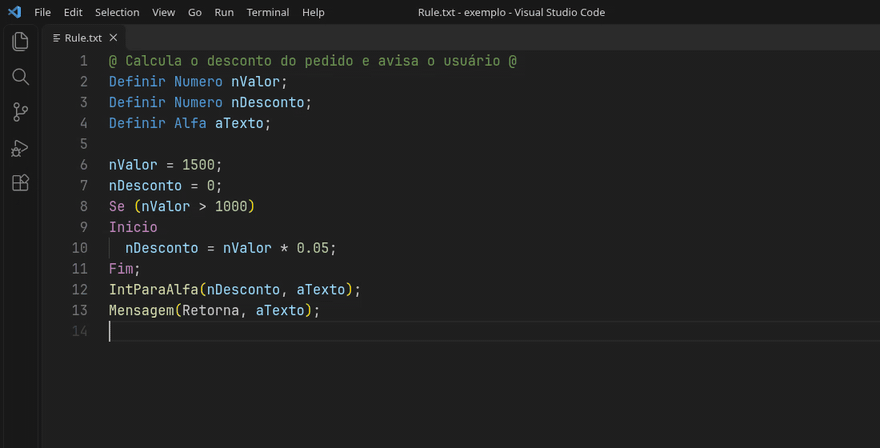

# senior-lsp

Servidor de linguagem ([Language Server Protocol](https://microsoft.github.io/language-server-protocol/))
para as regras LSP do ERP Senior, como o gerenciador de artefatos exporta. Ele aponta no editor os
erros que o compilador do ERP daria, sem precisar compilar a regra no ERP, e ajuda a navegar em
regras grandes.



> [!IMPORTANT]
> **Aviso legal**
>
> O senior-lsp é um projeto pessoal e independente, sem vínculo, patrocínio ou endosso da Senior
> Sistemas. Não é uma ferramenta oficial e não substitui o compilador, a documentação nem o suporte
> do ERP. Quando o servidor e o ERP discordarem, na compilação ou na execução, vale o ERP.
>
> O repositório não contém nem distribui código-fonte, binários ou regras da Senior Sistemas. Os
> nomes e marcas da Senior Sistemas pertencem a ela e aparecem aqui só para identificar o sistema
> com que o servidor trabalha.
>
> O software é fornecido no estado em que se encontra, sem garantias, nos termos da
> [licença MIT](LICENSE).

O servidor oferece:

- os erros de sintaxe e de tipo que o compilador do ERP daria, com o texto da mensagem dele, e
  avisos de código que compila mas faz outra coisa do que parece. Cada diagnóstico tem um
  [código fixo](docs/diagnosticos.md), que dá para esconder ou mudar de nível
- a conferência do SQL dos cursores, do `ExecSql` e do `SQL_DefinirComando` contra o dicionário de
  dados do ERP
- ir para a definição, achar as referências e renomear variáveis, funções, parâmetros e rótulos,
  também entre as regras de uma tela SGI e de um modelo de relatório
- achar onde um campo do dicionário é usado em todas as regras da pasta
- a hierarquia de chamadas e a contagem de referências de cada função
- refactors (extrair e embutir função, extrair variável, inverter o `se`, envolver com `se` ou
  `enquanto`, tirar, mover e acrescentar parâmetro) e correções rápidas, com a ação "Corrigir o
  arquivo" para as que não mudam o que a regra faz
- hover com a declaração, o campo do dicionário e, nas funções do ERP, o link da documentação da
  Senior, e completar de nomes, campos e tabelas, inclusive dentro do SQL
- formatação do recuo e do espaço dentro das linhas, também ao digitar
- as regras da exportação do gerenciador de artefatos (regras, telas SGI, web services e modelos de
  relatório) e a análise da pasta inteira de uma vez

A lista completa está em [docs/recursos.md](docs/recursos.md).

## Instalar

### VS Code

Instale pela busca de extensões do VS Code, procurando "Senior LSP", pela
[página no Marketplace](https://marketplace.visualstudio.com/items?itemName=eduardoghi.senior-lsp)
ou pelo terminal:

```sh
code --install-extension eduardoghi.senior-lsp
```

Na primeira vez, a extensão baixa o binário do servidor do release do GitHub. As configurações
estão em [docs/editores.md](docs/editores.md#vs-code).

### Claude Code

```sh
claude plugin marketplace add eduardoghi/senior-lsp
claude plugin install senior-lsp@senior-lsp
```

Numa sessão aberta, `/reload-plugins --force` carrega o plugin. Com ele, o Claude recebe os
diagnósticos da regra enquanto edita.

### Outros editores

O servidor conversa pelo stdin e stdout, como qualquer servidor LSP. Os
[releases](https://github.com/eduardoghi/senior-lsp/releases) trazem o binário para Linux x86_64 e
Windows x86_64. Em outro sistema, [compile a partir do código](docs/editores.md#compilar). A
configuração do Kate e as opções que qualquer editor pode mandar estão em
[docs/editores.md](docs/editores.md).

## Dicionário de dados

Com o `.tbs` do ERP (como o `sapiens.tbs`), o servidor confere o tipo dos campos e o SQL contra as
tabelas. No VS Code, o caminho vai em `seniorLsp.tbsProducao`. No Claude Code, o plugin pergunta
na instalação. Os detalhes, como o `.tbs` da base de teste, estão em
[docs/configuracao.md](docs/configuracao.md#dicionário-de-dados).

## Documentação

- [Recursos](docs/recursos.md)
- [Regras da exportação](docs/regras.md)
- [Diagnósticos](docs/diagnosticos.md)
- [Configuração](docs/configuracao.md)
- [Editores](docs/editores.md)

## Licença

[MIT](LICENSE)
